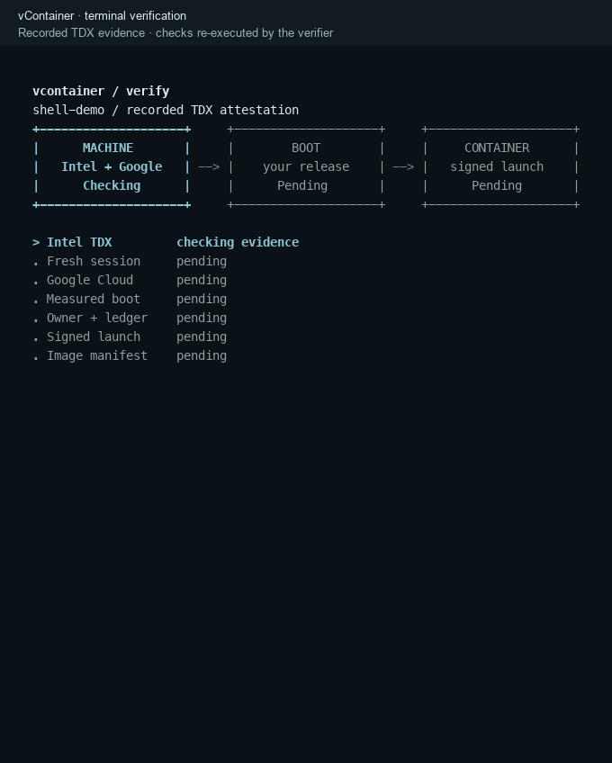

# vContainer

vContainer runs **containers and AI agents in confidential VMs**, with **as little code as possible**. You can **verify the VM's boot image and recorded container launch** before authorizing execution.

[](LICENSE)
[](rust-toolchain.toml)
[](#trust)
[](#install)

An agent in the cloud holds API keys and often handles private data. On an ordinary VM, the cloud host can read both. A confidential VM keeps its memory encrypted from the host, and the hardware signs a quote of what the VM booted.

You bring a container image and any secrets it needs. vContainer creates the VM, verifies what booted, delivers your secrets encrypted to that VM, and starts the container only after verifying its recorded launch. You can share a policy file so others can check the same evidence.

**Small by design.** Before your container starts, the guest runs only Linux and `/init`:

| Part | Size | Code |
| --- | --- | --- |
| Guest `/init`, protocol, and OCI client | **~1,450 lines of Rust** | [Guest](crates/init/src) · [Core](crates/core/src) |
| CLI and verifier, on your machine | **~1,500 lines of Rust** | [CLI](crates/cli/src) |
| Kernel configuration | **107 options** on top of `allnoconfig` | [Kernel config](image/kernel.config) |

Line counts cover our own implementation, excluding blank lines, full-line comments, and tests. Linux and third-party dependencies are additional code the system relies on.

The current implementation runs on **Intel TDX / Google Cloud C3**.

<a id="quick-start"></a>

## Example: hello-world

After the one-time [setup](#get-started), run Docker Hub's hello-world image in a verified confidential VM. No API key or application build is needed.

Create a verified VM, deploy hello-world, and inspect its output and final attestation:

```sh
vcontainer run --session demo
vcontainer deploy --session demo docker.io/library/hello-world:latest
vcontainer logs --session demo
vcontainer verify --session demo
```

Look for `Hello from Docker!` in the logs. The terminal follows the evidence from machine identity to measured boot and the container launch. Each node advances only after its checks pass; the final receipt shows the complete boot measurements together:



This terminal recording re-runs the verifier on signed evidence saved from the real Intel TDX test. See the [final receipt](docs/assets/hello-world-shell-verification.jpg), [failure view](docs/assets/hello-world-shell-rejected.jpg), or [full test transcript](docs/assets/hello-world-shell-output.txt). The test included a deployment rejected before launch with an incorrect policy. IP addresses are redacted and the cloud resources have been deleted. Add `--details` for full release and platform claims.

The VM keeps billing until you remove it:

```sh
vcontainer rm --session demo
```

## Get started

<a id="install"></a>
<a id="boot-image-and-application-image"></a>

Build and publish vContainer's **boot image** once. Your **application image** is separate: changing your container or agent does not require rebuilding the boot image.

You need a Linux x86-64 build machine with Python 3.9+, a C toolchain, Git, Bash and Docker, plus authenticated `gcloud` and a Google Cloud project with billing and C3 quota. Application images must target `linux/amd64` and fit in the VM's RAM. See [Installation](docs/install.md) for full prerequisites and permissions.

Clone the repository and run the remaining setup commands from its root:

```sh
git clone https://github.com/Mengyuan-L/vContainer && cd vContainer
```

Replace `PROJECT` with your project ID:

```sh
gcloud auth login &&
  gcloud config set project PROJECT &&
  gcloud services enable compute.googleapis.com
```

Build the boot image, install the CLI, and publish the image:

```sh
python3 scripts/install.py --publish --project PROJECT
```

Make the CLI available in this terminal if needed:

```sh
export PATH="$HOME/.cargo/bin:$PATH"
```

Setup publishes an image and saves its expected measurements; it does not start a VM. Continue with the [hello-world example](#quick-start).

<a id="cli-only-on-macos-or-another-linux-machine"></a>

**Using a Mac?** Build and publish the boot image on Linux first, then follow [CLI-only setup](docs/install.md#cli-only-on-macos-or-another-linux-machine). For application ports, secrets and cleanup, see [Deploy a container](docs/deploy-a-container.md).

## How verification works

<a id="how-it-works"></a>

The VM boots a measured Linux kernel with `/init` built in. There is no separate bootloader, disk-backed root filesystem or container engine. Deployment has two checks: the empty VM, then the recorded container launch. The image is pulled only after both checks and your signed authorization:


<a id="verify-and-share"></a>

Secrets are encrypted to the verified VM's boot key and appear as files in `/run/secrets`. A shared verification policy lets others check the same boot and launch evidence without your private key or cloud account. See [Verify and share](docs/verify-and-share.md) for the commands and required network access.

<a id="more-examples"></a>
<a id="an-agent-with-tools-review-a-pull-request"></a>

## Agent example: code review

The included [PR review agent](examples/pr-review-agent) reviews a GitHub pull request at a pinned commit. The model reads the diff and repository files through five tools, without a shell. Its published image needs no application build; you provide an OpenRouter API key as an encrypted secret.

In the recorded demo, it found the three planted bugs and an additional cache problem by reading an unchanged file. Follow [Review a public pull request](docs/review-a-public-pull-request.md) for the commands and sample review.

<a id="review-a-private-pull-request"></a>

For private code, set `OUTPUT=post` and provide a repository-scoped GitHub token; use `--quiet` to keep output off the serial console. The host does not see the container's output; GitHub, OpenRouter and the model's provider still receive the code. See [Review a private pull request](docs/review-a-private-pull-request.md). To deploy your own workload, follow [Deploy your own agent](docs/deploy-your-agent.md).

## Agent example: private data analyst

The included [data analyst](examples/data-analyst) is a service that teammates query about a dataset of support tickets sealed to the VM. Its three tools return only counts and averages, so neither the model provider nor the people asking see rows, names or emails, and the cloud host sees none of the data. Aggregates can still reveal facts about individuals across several questions, so this is not a statistical privacy guarantee. Teammates ask with `ask.py`, which verifies the session against the custodian's policy and pins the service's TLS certificate before it sends anything. Its published image needs no application build; see the [example](examples/data-analyst/README.md) for the commands.

<a id="trust"></a>

## Security and limitations

Each VM boot runs one container, with its root filesystem in RAM. vContainer protects memory from the cloud host; you still trust the agent and its external services. It provides no outbound destination filtering or agent tool policy, and application TLS and authentication are your responsibility.

Secret values are encrypted. Launch settings, environment variables and secret names are public; container output is host-readable unless you use `--quiet`. A verified image digest identifies what ran, but does not prove its source or safe behavior. The [full trust model](docs/security.md) lists the hardware, firmware and host-configuration assumptions.

<a id="learn-more"></a>
<a id="command-reference"></a>
## Documentation

- [Installation](docs/install.md): prerequisites, macOS setup and build options.
- [Command reference](docs/command-reference.md): CLI commands and configuration.
- [Whitepaper](docs/whitepaper.md): evidence, implementation and security analysis.
- [Boot image](image/README-image.md): kernel configuration and reproducible builds.

## License

The vContainer Rust workspace is licensed under the [Apache License 2.0](LICENSE). The Linux kernel and third-party dependencies retain their own licenses.
