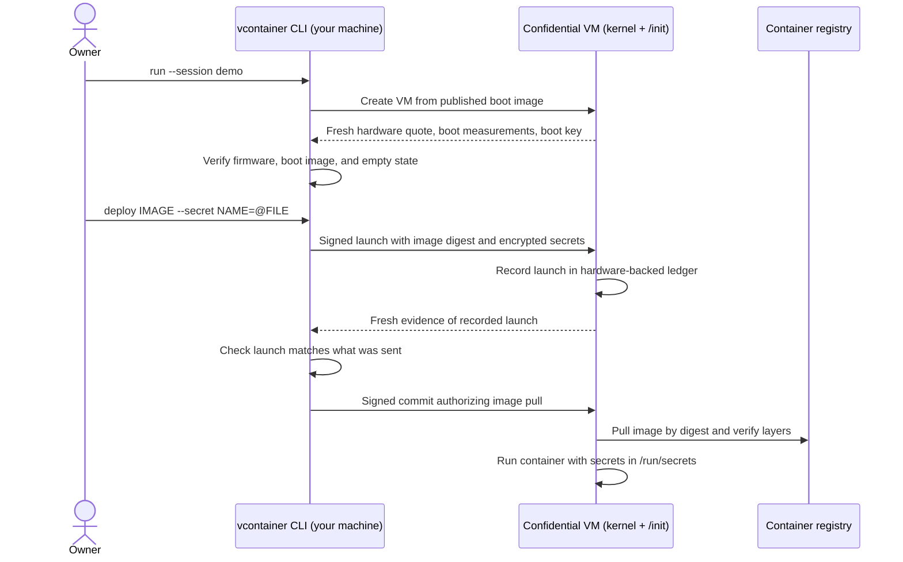

# vContainer

Deploy your agent in a confidential VM in the cloud, keeping its memory and secrets private from the cloud host.

vContainer manages deployment and verification for your containerized agent. You bring the container image and API keys; vContainer creates the VM, verifies what booted, delivers your keys encrypted to that VM, and starts the agent only after verifying its recorded launch. The current implementation runs on Intel TDX confidential VMs on Google Cloud C3.

- **Deploy:** run an ordinary `linux/amd64` agent container in a confidential VM.
- **Verify:** check hardware evidence of the VM's boot image and the exact agent launch.
- **Deliver secrets:** encrypt API keys to the verified VM and expose them to your agent as files.
- **Share verification:** give your users a policy file so they can check the same evidence.

| Deployment guide | Start with |
|---|---|
| [Deploy a container](docs/deploy-a-container.md) | A public hello-world image or another container you already have |
| [Deploy an OpenRouter agent](docs/deploy-an-openrouter-agent.md) | The included Python agent and your OpenRouter API key |
| [Deploy your own agent](docs/deploy-your-agent.md) | Your agent code and a Dockerfile |

To try it first, [install vContainer](#install) and [run hello-world](#example-1-a-public-image). For the privacy boundary, including application traffic and logs, see [Trust](#trust).

## How it works

The steps below are for the demo platform, Intel TDX on Google Cloud C3.



1. **Boot and measure.** `vcontainer run` creates the VM. Before anything else, `/init` records a fresh key for this boot, then your public key, in a hardware register that can only be extended.
2. **Verify the empty VM.** Your machine asks the VM for a quote over a fresh nonce and checks it: Intel's signature, Google's signed firmware, the exact boot image and the recorded keys.
3. **Launch, verify, commit.** `vcontainer deploy` sends a launch signed with your key: the image digest, the container settings, and the secrets, encrypted to the boot key. `/init` records the launch. Your machine checks that the record is the launch it sent, and only then lets the VM pull.
4. **Pull and run.** The VM pulls the image by digest, checks every layer and starts the container. Secrets appear as files in `/run/secrets`.

As a result, you have verified the VM's boot and its empty state before it pulls anything, and secrets reach only that VM. The container cannot extend the register or request quotes over its own data, so it cannot forge the evidence.

The VM boots a single file: a Linux kernel with a built-in initramfs whose only program is `/init`. There is no bootloader, root disk, systemd or container runtime. Until a container is deployed, the VM runs only the kernel and `/init`. The build is designed to be reproducible, and the file's measurement is predicted offline.

## Install

### Prerequisites

- Python 3.9+ for the installer; it uses only the standard library.
- A native C linker/toolchain for the CLI. The installer runs `rustup` to prepare the repository's Rust toolchain (pinned to 1.95.0). If rustup is missing, it downloads and runs the official installer; this requires `curl` and `sh`.
- To build the boot image: **Linux x86-64**, Git, Bash, and a running Docker daemon accessible without `sudo`. Kernel and disk-building tools run inside the pinned Docker build container.
- To publish or run VMs: `gcloud`, logged in with `gcloud auth login`, and a Google Cloud project with Compute Engine enabled. You need permission to create Cloud Storage buckets/objects and Compute Engine images; running sessions also needs VM/network/firewall permissions and C3 quota in your zone.

The installer sets up Rust automatically and checks the other prerequisites; install those tools yourself before running it. It reuses rustup when available, leaves your global Rust default and shell startup files unchanged, and makes Cargo available immediately for the remaining setup steps. The first build downloads Rust dependencies, the kernel source, and the build container's packages.

### Build, install, and publish on Linux x86-64

Get the code:

```sh
git clone https://github.com/Mengyuan-L/vContainer && cd vContainer
```

Preview the setup commands without executing anything:

```sh
python3 scripts/install.py --publish --project PROJECT --dry-run
```

Replace `PROJECT` with your project ID and run setup:

```sh
python3 scripts/install.py --publish --project PROJECT
```

This builds `/init`, the kernel, and the boot disk through `scripts/build-image.sh`; installs the Rust CLI; checks its help and expected measurements; then publishes the image to Google Cloud. Publishing creates cloud resources (a storage bucket if needed, an uploaded disk, and a Compute Engine image); it does not start a VM. The installer stops on the first failed command. It can be invoked from any working directory.

The `vcontainer` executable normally goes in `~/.cargo/bin`. Add that directory to your shell's `PATH` if needed:

```sh
export PATH="$HOME/.cargo/bin:$PATH"
```

Set the project for subsequent CLI commands; the installer's `--project` applies only to that setup invocation:

```sh
gcloud config set project PROJECT
```

Then continue with [Example 1](#example-1-a-public-image).

| Setup option | What it does |
|---|---|
| No flags | Builds the boot image and installs the CLI locally; does not access Google Cloud. Publish later with `vcontainer publish`. |
| `--publish --project PROJECT` | Also publishes the boot image and saves the local release settings. |
| `--cli-only` | Installs only the CLI; useful on macOS or when the boot image is already published. |
| `--dev` | Allows local source changes; the resulting image is not recorded as a release from a clean commit. |
| `--clean` | Drops cached kernel source/objects before building; clean release builds already do this. |
| `--install-root PATH` | Chooses the Cargo installation root; the executable goes under `PATH/bin`. Defaults to `CARGO_INSTALL_ROOT`, then `CARGO_HOME`, then `~/.cargo`. |
| `--dry-run` | Prints commands without executing them or checking prerequisites. |

Use `python3 scripts/install.py --help` for all options. The installer covers normal setup; the hardware diagnostic probe scripts are a separate workflow in [image/README-image.md](image/README-image.md).

### CLI only on macOS or another Linux machine

The CLI runs on Linux and macOS (Apple Silicon or Intel). In a checkout on the client machine:

```sh
python3 scripts/install.py --cli-only
```

Build and publish the boot image on a Linux x86-64 machine first. Copy its `~/.config/vcontainer/release.json` to that same path on your client, authenticate `gcloud`, and set the same project. Each client creates its own owner key on first use; you do not need to copy the builder's private key.

### What gets built and saved

There are two different images:

| Image | Purpose | When to rebuild |
|---|---|---|
| **Boot image**, built by this repository | Kernel + `/init` that records and launches your workload | When vContainer itself changes |
| **Application/container image**, supplied by you or a registry | Your agent or other application, as a `linux/amd64` OCI image | When your application changes; no boot-image rebuild needed |

Local boot artifacts are in `out/`: `BOOTX64.EFI`, `disk.raw`, `vcontainer.tar.gz`, measurements, and build metadata. Publishing writes `~/.config/vcontainer/release.json`, which tells the CLI which cloud image and measurements to expect. Your owner key and session files also live in `~/.config/vcontainer`.

<details>
<summary>Equivalent manual setup commands (from the repository root)</summary>

```sh
scripts/build-image.sh
cargo install --locked --path crates/cli
gcloud config set project PROJECT
vcontainer publish
```

</details>

Release builds require a clean Git checkout. While changing code or documentation, use `python3 scripts/install.py --dev` (or `scripts/build-image.sh --dev` for a manual build). Anyone can rebuild a release byte for byte from its commit, which `vcontainer publish` records and `vcontainer verify` prints. To inspect measurements later without publishing, run `vcontainer measure`.

## Usage

A session is one VM, and each boot of it runs one container. You start a session, deploy one container into it, and remove the session when you are done. Try the examples below, or use the deployment guides above for a full walkthrough from prerequisites to cleanup.

### Example 1: a public image

For setup and more container options, follow [Deploy a container](docs/deploy-a-container.md).

Start a session named `demo`. The CLI creates the VM and verifies it before anything is sent to it:

```sh
vcontainer run --session demo
```

While the CLI verifies, it draws a padlock in text whose shackle drops and locks; other steps show a spinner. Each step then leaves one `✓` line with how long it took, and the result lists every check. `[IP]`, `[ZONE]` and `[ID]` stand for your session's values:

```console
✓ network and firewall ready (9.1s)
✓ created TDX confidential VM demo: c3-standard-4 in [ZONE] (10.7s)
✓ demo booted and passed verification (12.7s)
session demo ([IP], [ZONE]): VERIFIED
  ✓ Intel TDX quote: signature valid, TCB UpToDate (evaluation 20)
  ✓ fresh quote for our nonce; state Waiting
  ✓ TD attributes: debug off (0x10000000), XFAM 0x602e7
  ✓ GCE instance [ID] in [ZONE] (MROWNER)
  ✓ firmware: MRTD c1ee9c16e3afc506… endorsed by Google (svn 2)
  ✓ host: a Google Cloud machine (PPID in Google's host registry)
  ✓ boot image: kernel+initramfs+cmdline+/init with Authenticode 24e25d82…3dc9fd7d (release vcontainer-24e25d8234a7, commit c2f795b3…)
  ✓ ledger: fresh boot key, our owner key
  state: Waiting
```

This takes about 35 seconds. Deploy Docker Hub's `hello-world` image into the verified VM. Images are always named in full, with the registry host and a tag or digest:

```sh
vcontainer deploy --session demo docker.io/library/hello-world:latest
```

The CLI resolves the tag to a digest, sends the launch, checks that the VM recorded it, and only then lets the VM pull. The container prints its message and exits, so the session ends in state `Exited (exit code 0)`. Read the message from the serial console:

```sh
vcontainer logs --session demo
```

Remove the session. The VM bills until you do, even after its container exits:

```sh
vcontainer rm --session demo
```

### Example 2: a public agent with an API key

Docker's [docker-agent](https://docs.docker.com/ai/docker-agent/) image runs an LLM agent and serves it as an OpenAI-compatible chat API. Nothing needs to be built: the image comes from Docker Hub, and the deploy command below gives it a small agent configuration that uses an OpenRouter model.

Save your OpenRouter API key in a file named `openrouter.key` that holds only the key. Then make a random access token for your chat clients; the agent answers only requests that carry it:

```sh
openssl rand -hex 16 > chat.key
```

Start a session:

```sh
vcontainer run --session chat
```

Deploy the agent with both keys as secrets. The command after `--` writes the agent configuration, reads the two secrets from `/run/secrets`, and starts the chat server on port 8080:

```sh
vcontainer deploy --session chat docker.io/docker/docker-agent:latest -p 8080 --secret OPENROUTER_API_KEY=@openrouter.key --secret CHAT_TOKEN=@chat.key -e TELEMETRY_ENABLED=false --entrypoint sh -- -c 'printf "agents:\n  root:\n    model: openrouter/openai/gpt-4o-mini\n    instruction: You are a helpful assistant.\n" > /tmp/agent.yaml && OPENROUTER_API_KEY=$(cat /run/secrets/OPENROUTER_API_KEY) CHAT_TOKEN=$(cat /run/secrets/CHAT_TOKEN) exec /docker-agent serve chat /tmp/agent.yaml --listen 0.0.0.0:8080 --api-key-env CHAT_TOKEN'
```

The agent configuration and the command are part of the measured launch, so `vcontainer verify` shows them; the two keys are not. Set `IP` to the address that `vcontainer deploy` printed (the one below is only an example):

```sh
IP=203.0.113.7
```

Ask the agent a question with your access token. Without the token it answers `401`:

```sh
curl "http://$IP:8080/v1/chat/completions" -H "Authorization: Bearer $(cat chat.key)" -H "Content-Type: application/json" -d '{"model":"root","messages":[{"role":"user","content":"Reply with exactly: vContainer works"}]}'
```

The token keeps others from using your key, but the traffic is plain HTTP, so the host can read it (see [Trust](#trust)). Remove the session when you are done:

```sh
vcontainer rm --session chat
```

### Example 3: your own agent image, with an API key

Follow [Deploy your own agent](docs/deploy-your-agent.md) for the complete path from a Dockerfile to a verified deployment, including registry setup, secret delivery, updates, and cleanup.

For a working application you can adapt, follow [Deploy an OpenRouter agent](docs/deploy-an-openrouter-agent.md). The included demo reads its API key from `/run/secrets/OPENROUTER_API_KEY` and serves `POST /chat` through OpenRouter.

### Command reference

**`vcontainer run --session NAME`** creates a VM, or reconnects to an existing one, and verifies it. Options:

- `--zone ZONE` and `--machine-type TYPE` choose where and what to run (defaults: `us-central1-a`, `c3-standard-4`).
- `--allow-from CIDR` sets who can reach the attestation port (7700) and the container's ports (default: your public IP).

`--allow-from` and published ports control incoming connections only. vContainer does not implement outbound destination filtering or an egress allowlist.

**`vcontainer deploy --session NAME IMAGE`** verifies the session, sends the launch, verifies that the VM recorded it, and then lets the VM pull and start the image. `vcontainer pull` is an alias. Options:

- `-p PORT` opens a container port to the `--allow-from` range.
- `-e KEY=VALUE` sets an environment variable. Variables are public (see [Trust](#trust)).
- `--secret NAME=@FILE`, `--secret NAME=VALUE` or `--secret NAME` (taken from your environment) encrypts a secret to the VM. It appears as `/run/secrets/NAME`.
- `--user`, `--workdir` and `--entrypoint` override the image's settings, and `-- CMD ARGS...` at the end overrides its command.
- `--quiet` keeps container output off the serial console.
- `--resume` finishes a deploy that was interrupted after its launch was sent but before the commit.

`IMAGE` is a full reference, `HOST/REPOSITORY:TAG` or `HOST/REPOSITORY@DIGEST`; nothing is filled in for you. Images must be linux/amd64 and fit in RAM. The kernel is minimal; for example, it has no user namespaces or io_uring. A tag is resolved to a digest before launch, and the digest is what gets measured. Public images are pulled without credentials (Docker Hub is tested); private images work on Artifact Registry and gcr.io, where your `gcloud` access token is sealed to the VM.

**`vcontainer verify --session NAME`** verifies a session again at any time. `--export-policy FILE` also writes what a third party needs: the expected measurements, your public key, the instance and the exact launch, but no secrets:

```sh
vcontainer verify --session agent --export-policy agent-policy.json
```

With that file and the session's address in `IP`, anyone who can reach port 7700 verifies the session, without your key or your cloud account:

```sh
vcontainer verify --url "http://$IP:7700" --policy agent-policy.json
```

**`vcontainer logs --session NAME`** prints the serial console: kernel, `/init` and container output. **`vcontainer ls`** lists your sessions and what each one runs. **`vcontainer rm --session NAME`** deletes the VM and its firewall rule.

## Trust

On the demo platform, vContainer trusts:

- Intel: the CPU, the TDX module and the quoting enclave;
- Google's TDX firmware, as checked against Google's signed launch endorsement;
- the host's default configuration (ACPI tables and the KVM paravirtual interface), which is trusted, not checked;
- you, the owner.

The host is otherwise untrusted: it controls the network, instance metadata, the disk, the serial console and the path to the registry. The container's isolation exists so that the container cannot forge the evidence. It is not a sandbox for untrusted code.

vContainer protects the agent's memory from the cloud host. You still need to trust the agent code: there is no built-in egress control or agent tool policy, and the agent can send data to external services. Application authentication and TLS are your responsibility.

Only secret values and the registry token are encrypted, and the container itself can still leak them. The rest is public:

- the launch configuration (image, command, environment variables and secret names), which anyone can read from the ledger;
- container output, which goes to the host-readable serial console unless you pass `--quiet`;
- traffic to the container's ports, which vContainer does not encrypt. The agents in the examples serve plain HTTP. To protect this traffic, have the container serve TLS with a key passed through `--secret`, and publish the key's fingerprint with `-e` so clients can check it against the verified evidence.

## Status

Version 0.1 works end to end on real hardware. The release built from commit c2f795b was rebuilt from scratch, also in a fresh clone, and matched byte for byte.

Intel TDX on Google Cloud C3 is a demo platform, not part of the design. The design needs a measured boot, an append-only measurement register and quotes that bind data chosen by the guest. Supporting another platform means replacing the TDX and Google Cloud parts of `/init`, the verifier, the CLI's cloud commands, the kernel configuration and the image build.

The code had three Codex review rounds and one adversarial multi-agent review, and every confirmed finding was fixed. A later audit replaced the fixes that had piled up over those rounds with one mechanism each. [Whitepaper §8](docs/whitepaper.md#8-security-analysis) summarizes both.

Limits:

- One container per VM boot, with its root filesystem in RAM.
- After host maintenance the VM reboots empty: run `vcontainer run`, then `vcontainer deploy`, again.
- There is no SEV-SNP support. On Google Cloud's generally available SNP machines, the kernel can be identified only through a vTPM that the host runs. [docs/design](docs/design/) has the analysis.

## Learn more

- [Deploy a container](docs/deploy-a-container.md) starts with a public image and covers configuration, logs, verification, and cleanup.
- [Deploy an OpenRouter agent](docs/deploy-an-openrouter-agent.md) deploys the included demo with an encrypted API key.
- [Deploy your own agent](docs/deploy-your-agent.md) covers prerequisites, building your image, secret delivery, deployment, verification, and cleanup.
- [docs/whitepaper.md](docs/whitepaper.md) presents the design top-down: what a PASS establishes, what it does not, and why.
- [image/README-image.md](image/README-image.md) covers the kernel configuration and the platform facts measured on real C3 hardware.
- [examples/openrouter-agent/README.md](examples/openrouter-agent/README.md) walks through building and deploying your own agent image.
- [scripts/install.py](scripts/install.py) orchestrates normal build/install/publish setup; [scripts/build-image.sh](scripts/build-image.sh) contains the reproducible boot-image build.
- Code:
  - [crates/core](crates/core): the protocol and the OCI client;
  - [crates/init](crates/init): the guest `/init`;
  - [crates/cli](crates/cli): the CLI and verifier.
