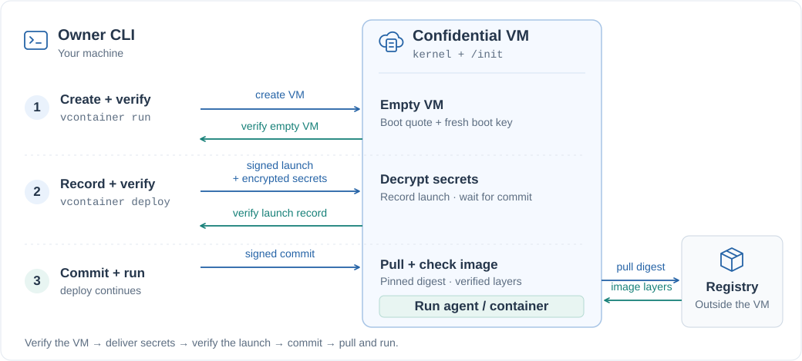

# vContainer

vContainer runs **containers and AI agents in confidential VMs**, with **as little code as possible**.

[](LICENSE)
[](rust-toolchain.toml)
[](#trust)
[](#install)

An agent in the cloud holds API keys and often handles private data. On an ordinary VM, the cloud host can read both. A confidential VM keeps its memory encrypted from the host, and the hardware signs a quote of what the VM booted.

You bring a `linux/amd64` container image and any secrets it needs. vContainer creates the VM, verifies what booted, delivers your secrets encrypted to that VM, and starts the container only after verifying its recorded launch. You can share a policy file so others can check the same evidence.

**Small by design.** Before your container starts, the guest runs only Linux and `/init`:

| Part | Size | Code |
| --- | --- | --- |
| Guest `/init`, protocol, and OCI client | **~1,450 lines of Rust** | [Guest](crates/init/src) · [Core](crates/core/src) |
| CLI and verifier, on your machine | **~1,100 lines of Rust** | [CLI](crates/cli/src) |
| Kernel configuration | **107 options** on top of `allnoconfig` | [Kernel config](image/kernel.config) |

Line counts cover our own implementation, excluding blank lines, full-line comments, and tests. Linux and third-party dependencies are additional code the system relies on.

The current implementation runs on **Intel TDX / Google Cloud C3**. See [Trust](#trust) for its security assumptions and limits.

[Quick start](#quick-start) · [Install](#install) · [More examples](#more-examples) · [How it works](#how-it-works) · [Command reference](#command-reference) · [Trust](#trust) · [License](#license)

**Choose a starting point:**

| You want to… | Start with | Guide |
| --- | --- | --- |
| Try a container | Hello-world or another container you already have | [Quick start](#quick-start) · [Full walkthrough](docs/deploy-a-container.md) |
| Run an agent with tools | The included PR review agent and an OpenRouter API key | [Agent example](#an-agent-with-tools-review-a-pull-request) |
| Deploy your own agent | Your agent code and a Dockerfile | [Deploy your own agent](docs/deploy-your-agent.md) |
| Understand the verification | The boot → launch → commit flow | [How it works](#how-it-works) · [Whitepaper](docs/whitepaper.md) |

## Quick start

Run Docker Hub's hello-world image in a verified confidential VM. You need the CLI installed, a boot image published to your Google Cloud project, and `gcloud` authenticated with that project selected; [Install](#install) covers setup. This example needs no API key or application build.

A **session** is one VM, and each VM boot accepts one container launch.

**1. Create and verify the VM.** On success, the CLI prints `VERIFIED` with state `Waiting`:

```sh
vcontainer run --session demo
```

**2. Deploy the container.** Always include the registry host, repository, and a tag or digest:

```sh
vcontainer deploy --session demo docker.io/library/hello-world:latest
```

The CLI resolves the tag to a digest, sends the signed launch, checks that the VM recorded it, and authorizes the pull. Hello-world prints its message and exits; `Exited (exit code 0)` is the expected final state.

**3. Read the output.** Look for `Hello from Docker!` in the logs:

```sh
vcontainer logs --session demo
```

**4. Clean up.** The VM keeps billing after its container exits:

```sh
vcontainer rm --session demo
```

The defaults are `us-central1-a` and `c3-standard-4`; new sessions restrict incoming connections to your public IP. See the [command reference](#command-reference) to change these settings, or [Deploy a container](docs/deploy-a-container.md) for a walkthrough that includes application ports and verification.

<details>
<summary>What successful VM verification looks like</summary>

The CLI shows progress while it works, then lists the checks it performed. This is an abbreviated example; instance details and measurements depend on your session and release:

```text
session demo ([IP], [ZONE]): VERIFIED
  ✓ Intel TDX quote: signature valid, TCB UpToDate (evaluation 20)
  ✓ fresh quote for our nonce; state Waiting
  ...
  ✓ ledger: fresh boot key, our owner key
  state: Waiting
```

The [whitepaper's worked example](docs/whitepaper.md#2-a-worked-verification-path) explains the hardware, firmware, boot image, and ledger checks.

</details>

## Install

The boot image is built on **Linux x86-64**. The CLI also runs on macOS; see [CLI-only setup](#cli-only-on-macos-or-another-linux-machine).

### Prerequisites

- Python 3.9+, a native C compiler/linker, Git, Bash, and a running Docker daemon accessible without `sudo`.
- `curl` and `sh` if rustup is not installed. The installer prepares Rust automatically, using the version pinned in `rust-toolchain.toml` (1.95.0).
- `gcloud` and a Google Cloud project with billing enabled, Compute Engine enabled, and C3 quota in your zone. You need permissions to manage VMs, images, networks, firewall rules, and Cloud Storage buckets and objects.

The installer sets up Rust and checks the other prerequisites. It leaves your global Rust default and shell startup files unchanged. Install the other tools yourself before running it.

### Build, install, and publish on Linux x86-64

Clone the repository and enter it:

```sh
git clone https://github.com/Mengyuan-L/vContainer && cd vContainer
```

Sign in, set your default project, and enable Compute Engine. Replace `PROJECT` with your project ID:

```sh
gcloud auth login &&
  gcloud config set project PROJECT &&
  gcloud services enable compute.googleapis.com
```

Build the boot image, install the CLI, and publish the image to that project:

```sh
python3 scripts/install.py --publish --project PROJECT
```

The first build downloads Rust dependencies, the kernel source, and builder packages. Publishing creates a Cloud Storage bucket if needed, uploads the boot disk, and creates a Compute Engine image. **It does not start a VM**; `vcontainer run` does that.

The installer uses `--project` only for that setup invocation, which is why the default project is set separately above. It installs `vcontainer` under `~/.cargo/bin` by default; make it available in this terminal if needed:

```sh
export PATH="$HOME/.cargo/bin:$PATH"
```

You are ready for the [Quick start](#quick-start).

| Setup option | What it does |
| --- | --- |
| No flags | Builds the boot image and installs the CLI; does not access Google Cloud. |
| `--publish --project PROJECT` | Also publishes the boot image and saves the local release settings. |
| `--cli-only` | Installs only the CLI, on Linux or macOS. |
| `--dev` | Allows uncommitted changes; a modified checkout is not recorded as a release from a clean commit. |
| `--clean` | Drops cached kernel source and objects. Clean release builds already do this. |
| `--install-root PATH` | Installs the executable under `PATH/bin`; otherwise uses `CARGO_INSTALL_ROOT`, `CARGO_HOME`, or `~/.cargo`. |
| `--dry-run` | Prints setup commands without executing them or checking prerequisites. |

For example, preview the complete setup with:

```sh
python3 scripts/install.py --publish --project PROJECT --dry-run
```

Release builds require a clean checkout. While changing code or documentation, add `--dev` to the installer command. See [scripts/install.py](scripts/install.py) for the setup workflow and [image/README-image.md](image/README-image.md) for the separate hardware probe workflow.

### CLI only on macOS or another Linux machine

Build and publish the boot image on Linux x86-64 first. On the client machine, install Python, a native C toolchain, and `gcloud`, then run this in a checkout:

```sh
python3 scripts/install.py --cli-only
```

Copy `~/.config/vcontainer/release.json` from the build machine to that same path on the client, authenticate `gcloud`, and set the same default project. Add the CLI's installation directory to `PATH` if needed. Each client creates its own owner key on first use; you do not need to copy the builder's private key.

### Boot image and application image

| Image | Purpose | When to rebuild |
| --- | --- | --- |
| **Boot image**, built by vContainer | Kernel + `/init`, which records and launches your workload | When vContainer itself changes |
| **Application image**, supplied by you or a registry | Your agent or other `linux/amd64` container | When your application changes |

Changing your agent does not require rebuilding the boot image. Build and push an application image with Docker, then deploy its full registry reference. See the [review agent's image-build instructions](examples/pr-review-agent/README.md#build-your-own-image).

Boot artifacts are saved in `out/`, including `BOOTX64.EFI`, `disk.raw`, measurements, and build metadata. Published release settings, your owner key, and session files live in `~/.config/vcontainer`.

<details>
<summary>Equivalent manual build, install, and publish commands</summary>

With Rust and the other prerequisites installed, run this from the repository root:

```sh
scripts/build-image.sh &&
  cargo install --locked --path crates/cli &&
  gcloud config set project PROJECT &&
  vcontainer publish
```

To inspect an existing build's measurements without publishing:

```sh
vcontainer measure
```

</details>

## More examples

### An agent with tools: review a pull request

The [pull request review agent](examples/pr-review-agent) works through tools. It reviews one GitHub pull request at one commit: the model reads the diff and other text files of the repository, including unchanged ones, through five tools, with no shell, and finishes with a review. Its image is on Docker Hub, so nothing needs to be built. Here it reviews [pull request #1](https://github.com/haoxxu/vContainer-review-demo/pull/1) of a small demo repository, which adds a function with three deliberate bugs.

Save your OpenRouter API key in a file named `openrouter.key` that holds only the key. Then start a session:

```sh
vcontainer run --session public-review
```

Deploy the agent, pinned by digest. The pull request and its commit are environment variables, so they are part of the measured launch; if the pull request has moved to another commit, the agent stops without reviewing it. The agent opens no port:

```sh
vcontainer deploy --session public-review docker.io/terryxhx/pr-review-agent@sha256:23c5696ea6a1544e3d82025d91c3ad74ecce14638abcaa8c56c6ed85933e2aad \
  -e PR_URL=https://github.com/haoxxu/vContainer-review-demo/pull/1 \
  -e HEAD_SHA=688c61413e4e9bf830a58bab3e344d25582b8a33 \
  --secret OPENROUTER_API_KEY=@openrouter.key
```

The deploy returns once the container runs, after about 15 seconds. The review takes a minute or two; then verify the session again:

```sh
vcontainer verify --session public-review
```

Expected output, abbreviated (not recorded with this image):

```console
public-review: VERIFIED
  ...
  ✓ launch measured before pull: docker.io/terryxhx/pr-review-agent@sha256:23c5696e…
  ✓ container sealed: manifest sha256:23c5696e…
  state: Exited (exit code 0)
  container: docker.io/terryxhx/pr-review-agent@sha256:23c5696e… env=["PR_URL=https://github.com/haoxxu/vContainer-review-demo/pull/1", "HEAD_SHA=688c61413e4e9bf830a58bab3e344d25582b8a33"] secrets={"OPENROUTER_API_KEY"}
```

The evidence names the agent's image, the pull request and the commit, and the exit code is part of the quote. Read the review from the serial console; `sed` skips the boot messages before it:

```sh
vcontainer logs --session public-review | sed -n '/^pr-review-agent:/,$p'
```

<details>
<summary>Recorded review output (from an earlier image, v2)</summary>

```console
pr-review-agent: haoxxu/vContainer-review-demo#1 at 688c61413e4e, model anthropic/claude-sonnet-5.5
  tool get_diff {"path": "notes/listing.py"}
  tool list_dir {"path": "notes"}
  tool read_file {"path": "notes/cache.py"}
  tool read_file {"path": "notes/db.py"}
  tool get_diff {"path": "notes/__init__.py"}

review of haoxxu/vContainer-review-demo#1 at 688c61413e4e: 4 comments

The new `list_notes` has four defects. Two of them make it wrong on every call, and one is a SQL injection. I read the diff and `notes/cache.py` and `notes/db.py`. I did not run the code.

notes/listing.py:16
  `Cache.get` raises KeyError on a miss or an expired entry. It never returns None, as its docstring in cache.py says. So the first call for any key raises KeyError and `list_notes` never reaches the database. Wrap the lookup in try/except KeyError and fall through to the query.
...
tokens: 9651 prompt, 1067 completion
vcontainer: container exited with 0
```

In this run the agent found the three planted bugs and further problems with the cache. It found the cache bug by reading `notes/cache.py`, a file the pull request does not change. The review varies from run to run.

</details>

The OpenRouter key is sealed to the VM, and the model never sees it: the agent calls OpenRouter itself and gives the model only its tools. Everything else here is public: the repository, the launch and the review on the serial console. OpenRouter and the model's provider see the code under review. Remove the session when you are done:

```sh
vcontainer rm --session public-review
```

### Review a private pull request

The same agent can review a pull request in a private repository and post the review there, while the host sees neither the code the agent reads, the token nor the review. You copy the demo repository into a private one, give the agent a GitHub token for that repository only, and keep the container's output off the serial console. The demo's code is public anyway; with your own private repository, the same steps keep its code from the host.

<details>
<summary>Set up and review a private pull request</summary>

This example also uses the [GitHub CLI](https://cli.github.com), `gh`, signed in with `gh auth login` to the account that will own the copy.

Copy the demo repository, with its history, into a new private repository named `review-demo`. "Use this template" does not work here: the branches of a template copy have unrelated histories, so GitHub cannot open a pull request between them. Create the empty repository:

```sh
gh repo create review-demo --private
```

Let `git` push to GitHub over HTTPS with your `gh` login (once per machine). If you push over SSH instead, skip this and push to `git@github.com:OWNER/review-demo.git` below:

```sh
gh auth setup-git
```

Clone the demo repository without a working tree:

```sh
git clone --bare https://github.com/haoxxu/vContainer-review-demo.git
```

Push every branch to your copy. Replace `OWNER` with your GitHub account, here and below:

```sh
git -C vContainer-review-demo.git push --mirror https://github.com/OWNER/review-demo.git
```

Open the pull request in your copy:

```sh
gh pr create --repo OWNER/review-demo --base main --head feat/list-notes --title "feat: add paginated note listing" --body "Adds list_notes, which lists the notes of one owner, a page at a time."
```

Create a [fine-grained personal access token](https://github.com/settings/personal-access-tokens/new) for this repository only. Under **Repository access**, choose **Only select repositories** and `review-demo`. Under **Permissions**, give **Contents** read-only and **Pull requests** read and write. Save the token in a file named `github.key` that holds only the token. Then start a session:

```sh
vcontainer run --session private-review
```

Deploy the same image as in the previous example. The copy keeps the demo's commits, so `HEAD_SHA` does not change. With `OUTPUT=post` and `GITHUB_TOKEN`, the agent posts its review to the pull request and prints nothing of the repository, and `--quiet` keeps even that off the serial console:

```sh
vcontainer deploy --session private-review docker.io/terryxhx/pr-review-agent@sha256:23c5696ea6a1544e3d82025d91c3ad74ecce14638abcaa8c56c6ed85933e2aad \
  -e PR_URL=https://github.com/OWNER/review-demo/pull/1 \
  -e HEAD_SHA=688c61413e4e9bf830a58bab3e344d25582b8a33 \
  -e OUTPUT=post \
  --secret OPENROUTER_API_KEY=@openrouter.key \
  --secret GITHUB_TOKEN=@github.key \
  --quiet
```

After a minute or two, verify the session:

```sh
vcontainer verify --session private-review
```

Expected output, abbreviated (not recorded with this image):

```console
private-review: VERIFIED
  ...
  state: Exited (exit code 0)
  container: docker.io/terryxhx/pr-review-agent@sha256:23c5696e… env=["PR_URL=https://github.com/OWNER/review-demo/pull/1", "HEAD_SHA=688c61413e4e9bf830a58bab3e344d25582b8a33", "OUTPUT=post"] secrets={"GITHUB_TOKEN", "OPENROUTER_API_KEY"}
```

`OUTPUT=post` and both secret names are part of the evidence, so whoever checks the session can see that the agent had a GitHub token and was set to post its review. The serial console shows the container start and exit, and nothing in between:

```sh
vcontainer logs --session private-review | tail -n 2
```

```console
vcontainer: container started: python3 -u /app/agent.py
vcontainer: container exited with 0
```

Open the pull request to read the review. It is a comment review of commit `688c6141`, posted by the account that owns the token, with inline comments on the lines it discusses:

```sh
gh pr view 1 --repo OWNER/review-demo --web
```

What this run keeps from whom:

- The host cannot read the code the agent reads, the token or the review. The token is sealed to the VM, the agent keeps the code in the VM's encrypted memory, its traffic to GitHub and OpenRouter is HTTPS, the container's output stays off the serial console, and the VM has no SSH or exec.
- The launch is public: the image, the commit and `PR_URL`, which names your repository.
- GitHub, OpenRouter and the model's provider see the code. So does anything your GitHub settings let read the repository, such as an app or automatic Copilot code review; vContainer does not change those settings. The host sees which servers the VM connects to and how much data it exchanges with them.
- The image is the one we publish, pinned by digest. `vcontainer verify` shows which image ran, but not that it was built from [examples/pr-review-agent](examples/pr-review-agent), so you trust its publisher. To run your own build, follow [Build your own image](examples/pr-review-agent/README.md#build-your-own-image) and deploy that reference instead.

Remove the session when you are done. The token and the private repository stay until you delete them on GitHub:

```sh
vcontainer rm --session private-review
```

</details>

## How it works

The VM boots a single measured file: a Linux kernel with a built-in initramfs whose only program is `/init`. There is no separate bootloader, disk-backed root filesystem, systemd, or container engine. Until a container is deployed, the VM runs only the kernel and `/init`, which links musl and crates such as rustls, hpke, and tar. The build is designed to be reproducible, and its expected boot measurement is computed offline.

Deployment has two verification points: the empty VM, then the recorded launch. The container image is pulled only after both checks:



1. **Boot and measure.** `/init` generates a fresh key for this boot and records it, followed by your public key, in an append-only hardware measurement register.
2. **Verify.** Your machine requests a quote over a fresh nonce and checks Intel's signature, Google's endorsed firmware, the exact boot image, and the recorded keys. At this point the VM is verified and empty.
3. **Launch and commit.** The CLI signs the launch configuration and encrypts secrets to the verified boot key. `/init` checks the request, decrypts the secrets, and records the launch. The CLI verifies that record, then signs a commit authorizing this exact launch on this VM boot.
4. **Pull and run.** Only after commit does the VM pull the image by digest, verify every layer, and start the container. Secrets appear as files in `/run/secrets`. The CLI verifies the resulting state.

The container cannot extend the measurement register or request quotes over its own data, so it cannot forge the evidence. The [whitepaper](docs/whitepaper.md) explains what each check establishes and the assumptions it relies on.

## Command reference

**`vcontainer run --session NAME`** creates a VM, or reconnects to an existing one, and verifies it. Options:

- `--zone ZONE` and `--machine-type TYPE` choose where and what to run (defaults: `us-central1-a`, `c3-standard-4`).
- `--allow-from CIDR` sets who can reach the attestation port (7700) and the container's ports (default: your public IP).

`--allow-from` and published ports control incoming connections only. vContainer does not implement outbound destination filtering or an egress allowlist.

**`vcontainer deploy --session NAME IMAGE`** verifies the session, sends the launch, verifies that the VM recorded it, and then lets the VM pull and start the image. `vcontainer pull` is an alias. Options:

- `-p PORT` opens that TCP port to the `--allow-from` range; there is no port remapping.
- `-e KEY=VALUE` sets an environment variable. Variables are public (see [Trust](#trust)).
- `--secret NAME=@FILE`, `--secret NAME=VALUE` or `--secret NAME` (taken from your environment) encrypts a secret to the VM. It appears as `/run/secrets/NAME`.
- `--user`, `--workdir` and `--entrypoint` override the image's settings, and `-- CMD ARGS...` at the end overrides its command.
- `--quiet` keeps container output off the serial console.
- `--resume` finishes a deploy interrupted after its launch reached the VM but before commit. Use it without an image or new launch options.

`IMAGE` is a full reference, `HOST/REPOSITORY:TAG` or `HOST/REPOSITORY@DIGEST`; nothing is filled in for you. Images must be linux/amd64 and fit in RAM. The kernel is minimal; for example, it has no user namespaces or io_uring. A tag is resolved to a digest before launch, and the digest is what gets measured. Public images are pulled without credentials (Docker Hub is tested); private images work on Artifact Registry and gcr.io, where your `gcloud` access token is sealed to the VM.

**`vcontainer verify --session NAME`** verifies a session again at any time. `--export-policy FILE` also writes what a third party needs: the expected measurements, your public key, the instance and the exact launch, but no secrets:

```sh
vcontainer verify --session public-review --export-policy review-policy.json
```

With that file and the session's address in `IP`, anyone who can reach port 7700 verifies the session, without your key or your cloud account:

```sh
vcontainer verify --url "http://$IP:7700" --policy review-policy.json
```

**`vcontainer logs --session NAME`** prints the serial console: kernel, `/init` and container output. **`vcontainer ls`** lists your sessions and what each one runs. **`vcontainer rm --session NAME`** deletes the VM, its firewall rule, and its local session record. Published images, Cloud Storage artifacts, and the shared network remain.

## Trust

On the demo platform, vContainer trusts:

- Intel: the CPU, the TDX module and the quoting enclave;
- Google's TDX firmware, as checked against Google's signed launch endorsement;
- the host's default configuration (ACPI tables and the KVM paravirtual interface), which is trusted, not checked;
- you, the owner.

The host is otherwise untrusted: it controls the network, instance metadata, the disk, the serial console and the path to the registry. The container's isolation exists so that the container cannot forge the evidence. It is not a sandbox for untrusted code.

vContainer protects the agent's memory from the cloud host. You still need to trust the agent code: there is no built-in egress control or agent tool policy, and the agent can send data to external services. Application authentication and TLS are your responsibility.

Only secret values and the registry token are encrypted, and the container itself can still leak them. The rest is public:

- the launch configuration (image, command, environment variables and secret names), which anyone can read from the ledger;
- container output, which goes to the host-readable serial console unless you pass `--quiet`;
- traffic to the container's ports, which vContainer does not encrypt. To protect this traffic, have the container serve TLS with a key passed through `--secret`, and publish the key's fingerprint with `-e` so clients can check it against the verified evidence.

## Status

Version 0.1 works end to end on real hardware. The release built from commit c2f795b was rebuilt from scratch, also in a fresh clone, and matched byte for byte.

Intel TDX on Google Cloud C3 is a demo platform, not part of the design. The design needs a measured boot, an append-only measurement register and quotes that bind data chosen by the guest. Supporting another platform means replacing the TDX and Google Cloud parts of `/init`, the verifier, the CLI's cloud commands, the kernel configuration and the image build.

The code had three Codex review rounds and one adversarial multi-agent review, and every confirmed finding was fixed. A later audit replaced the fixes that had piled up over those rounds with one mechanism each. [Whitepaper §8](docs/whitepaper.md#8-security-analysis) summarizes both.

Limits:

- One container per VM boot, with its root filesystem in RAM.
- After host maintenance the VM reboots empty: run `vcontainer run`, then `vcontainer deploy`, again.
- There is no SEV-SNP support. On Google Cloud's generally available SNP machines, the kernel can be identified only through a vTPM that the host runs. [docs/design](docs/design/) has the analysis.

## Learn more

| Start here | What it covers |
| --- | --- |
| [Deploy a container](docs/deploy-a-container.md) | A full walkthrough, including ports, logs, verification, and cleanup |
| [PR review agent](examples/pr-review-agent/README.md) | Agent tools, public and private repositories, and building your own image |
| [Deploy your own agent](docs/deploy-your-agent.md) | Building an application image and deploying it with encrypted secrets |
| [Whitepaper](docs/whitepaper.md) | What verification establishes, its assumptions, and the implementation |
| [Boot image](image/README-image.md) | Kernel configuration, reproducible builds, and hardware measurements |
| [Core](crates/core) · [Guest](crates/init) · [CLI](crates/cli) | Protocol and OCI client, guest `/init`, and local commands and verifier |

## License

The vContainer Rust workspace is licensed under the [Apache License 2.0](LICENSE). The Linux kernel and third-party dependencies retain their own licenses.
